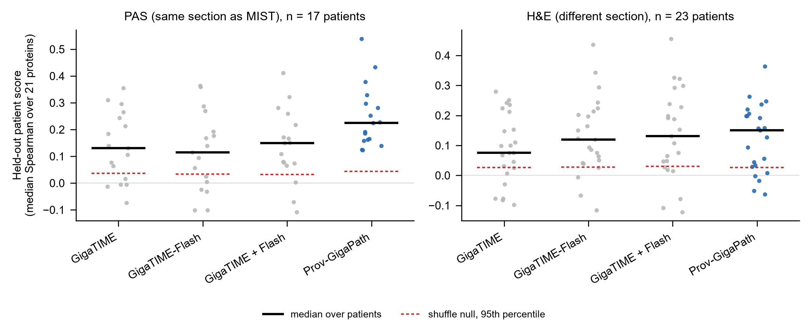
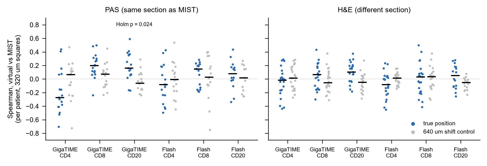
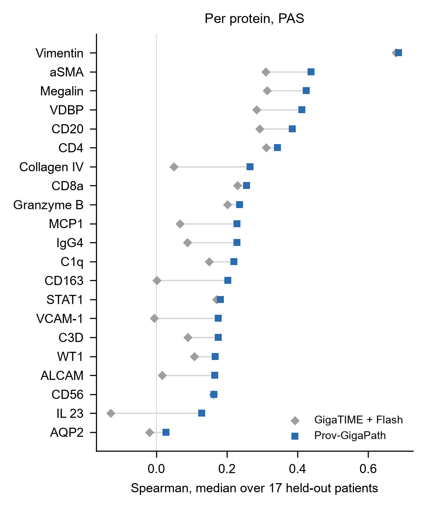
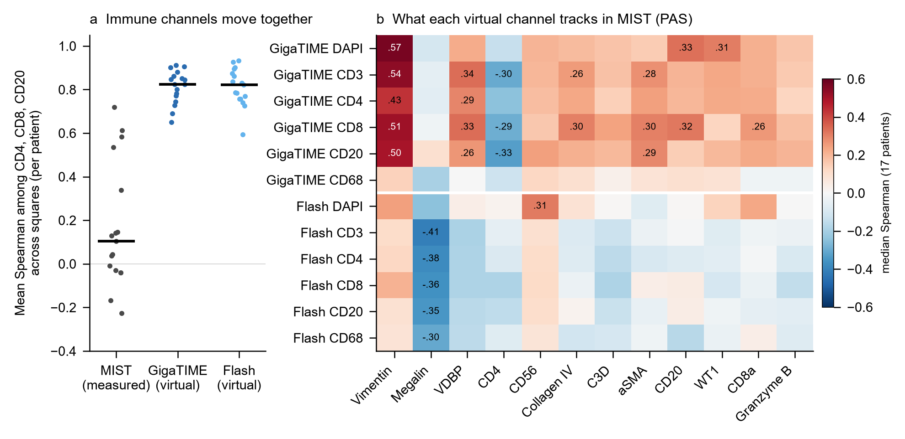

# Virtual immunofluorescence in kidney: GigaTIME and Prov-GigaPath against spatial proteomics

GigaTIME turns an H&E slide into 21 channels of virtual multiplex immunofluorescence. It was trained on lung cancer.
This repo tests whether that, and the Prov-GigaPath foundation model, carries over to a tissue neither was built for:
lupus nephritis kidney biopsies, where measured protein from MIST spatial proteomics is the ground truth.

## Headline

Trained comparison: ridge regression from frozen model outputs to 21 MIST proteins, leave one patient out (median
over patients of each held-out patient's median Spearman across 320 um regions):

| Features | PAS, same section (17 patients) | H&E, other section (23 patients) |
|---|---:|---:|
| Prov-GigaPath | **0.225** | **0.151** |
| GigaTIME + Flash virtual channels | 0.150 | 0.131 |
| GigaTIME virtual channels | 0.131 | 0.075 |
| GigaTIME-Flash virtual channels | 0.114 | 0.120 |
| shuffle null | 0.000 | 0.000 |

- GigaTIME's virtual immune channels collapse onto one axis in kidney. Virtual CD4, CD8 and CD20 correlate with
  each other at 0.82; the measured proteins correlate at 0.10. The virtual channels track interstitium versus tubule,
  not immune cell types.
- In direct comparison, without any training on our data, only virtual CD20 agrees with MIST beyond chance. Virtual
  CD4 is anti-correlated with measured CD4.
- Trained on MIST, Prov-GigaPath features beat GigaTIME's own virtual channels.
- A different section costs about a third of the signal: 0.22 on the MIST section, 0.15 on another one.

## Figures

### 1. Trained comparison



Each dot is one held-out patient; the bar is the median and the dashed line is the 95th percentile of a null in which
the patient's ground truth is shuffled across its regions. On PAS, Prov-GigaPath beats all three GigaTIME feature
sets (Holm p = 0.0006 to 0.015). On H&E no pair differs significantly.

### 2. Direct comparison



Each virtual channel against the same MIST protein, per patient (blue), and the same values paired with MIST 640 um
away (grey). Nothing is trained on our data here. Only GigaTIME CD20 on PAS survives Holm correction over the 48
tests: 0.16 vs -0.06, better than the control in 15 of 17 patients, Holm p = 0.024. On H&E the same channel is
borderline (Holm p = 0.055). Cell-level agreement is at most 0.07 for every channel.

### 3. Per protein



Trained comparison per protein on PAS. Structural and tubular proteins are predicted best by Prov-GigaPath (Vimentin
0.69; aSMA, Megalin and VDBP 0.41 to 0.44). GigaTIME's channels fall furthest behind on proteins with no matching
GigaTIME channel, such as IL-23, Collagen IV and VCAM-1.

### 4. Why the virtual channels fall short: compartment collapse



(a) Within each patient, virtual CD4, CD8 and CD20 move together across regions (median 0.82); the measured proteins
barely do (0.10). This holds in 17 of 17 PAS patients (Wilcoxon p = 1.5e-5) and on H&E (0.81 vs 0.06).
(b) What each virtual channel follows in MIST. GigaTIME's immune channels follow Vimentin, a marker of interstitium
(+0.43 to +0.57). GigaTIME-Flash's follow low Megalin, a proximal-tubule marker (-0.30 to -0.41). Neither follows the
protein it is named after, which is why virtual CD4 ends up anti-correlated with real CD4.

## Caveats

The cohort is small: 17 patients with PAS on the MIST section and 23 with H&E on a different section. Results are at
the region level (320 um); cell-level agreement is weak for every model. PAS is outside GigaTIME's training stain, and
the H&E results mix model error with section mismatch. Only frozen models were tested; fine-tuning on kidney was not
attempted. The pixel size and the two per-region summaries were chosen while looking at the data; the pixel size used
virtual DAPI only, and both summaries are inside the Holm correction.

## Data

Kidney biopsies from patients with lupus nephritis, profiled with MIST spatial proteomics (24 proteins at single-cell
resolution; the 21 present in every patient are used) and scanned as PAS and H&E. The patient data are not
redistributed and patients appear as P01 to P24. The scripts expect one folder per patient:

```
data/<patient>/cells.csv      MIST cells: Global X, Global Y (MIST pixels, 0.32495 um/px) and one column per protein
data/<patient>/PAS.tif, HE.tif
data/<patient>/PAS.json, HE.json   {"A_mist_to_stain": 2x3 affine, "stain_um_per_px": 0.274}
data/same_section.txt         patients whose PAS slide is the MIST section, one per line
```

The affine maps MIST pixels to slide pixels. Ours came from matching tissue outlines and then nuclei: the median
nuclear residual is 1 to 4 um for same-section PAS and 112 to 134 um for H&E.

## Method

| Model | Weights | Input | Used as |
|---|---|---|---|
| GigaTIME | `prov-gigatime/GigaTIME` | 512 px windows, stride 256, 0.25 um/px | 23 virtual channels |
| GigaTIME-Flash | `prov-gigatime/GigaTIME-flash` | 256 px windows, stride 128, 0.25 um/px | 23 virtual channels |
| Prov-GigaPath | `prov-gigapath/prov-gigapath` | 9 tiles of 224 px at 0.5 um/px | 1536-d embedding |

The MIST grid is cut into 320 um squares. A square is used when it holds at least 30 cells and 60% tissue: 692
squares on PAS and 1,253 on H&E. Each square is resampled from the slide onto the MIST grid with a 64 um margin.
Overlapping GigaTIME windows are blended with Hann-squared weights, which removes window seams. Virtual maps are
summarised per square as mean probability and fraction above 0.5 (46 numbers per model). Ground truth is the mean
log1p protein per square, z-scored within each patient.

Direct comparison: Spearman across a patient's squares between a virtual channel and the matching MIST protein, each
against a control 640 um away. Trained comparison: one ridge per protein (RidgeCV, 13 alphas from 0.1 to 1e5), leave
one patient out, with 200 within-patient shuffles as the null. Models are compared with paired Wilcoxon tests over
patients, Holm-corrected.

The GigaTIME paper describes 128 um tiles as 256 px (0.5 um/px), while the authors' code resizes 556 px to 512
(about 0.25 um/px). On one patient, averaged over the two GigaTIME models, virtual DAPI matched haematoxylin and
MIST nuclei better at 0.25 um/px (0.72 vs 0.47, and 0.63 vs 0.53), so 0.25 is used. A random-weight GigaTIME network
already reaches about 0.69 against haematoxylin, so only the difference between pixel sizes counts as evidence.

## Reproduce

```bash
pip install -r requirements.txt
python -c "from huggingface_hub import login; login()"   # the three models are gated: request access first

python scripts/01_pixel_size.py --patient P06       # optional: the pixel-size check
python scripts/02_run_models.py                     # GPU; about 2 h for 47 slides on one RTX PRO 6000
python scripts/03_evaluate.py
python scripts/04_figures.py
```

Model outputs go to `results/models/`, tables to `results/` and figures to `figures/`.

## References

- Valanarasu J.M.J. et al. Multimodal AI generates virtual population for tumor microenvironment modeling (GigaTIME). *Cell* 189:386-400, 2026. [doi:10.1016/j.cell.2025.11.016](https://doi.org/10.1016/j.cell.2025.11.016).
- Xu H. et al. A whole-slide foundation model for digital pathology from real-world data (Prov-GigaPath). *Nature* 630:181-188, 2024.

## Licence

Code is released under the [MIT licence](LICENSE). Patient data are not included. Model weights are subject to their
own licences on Hugging Face.
